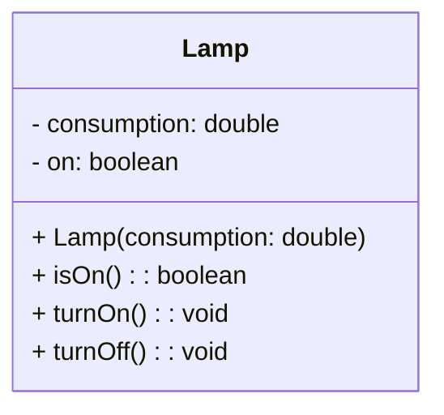

# Examen

Per als exàmens s'utilitza la plantilla `exam.html` junt amb el plugin [$access$], que protegeix el contingut de l'examen amb una contrasenya i, si cal, amb una finestra de temps. La resta de la pàgina, com aquesta explicació, continua sent pública.

````markdown title="docs/examen.md"
---
template: exam.html
---

/// access
    password: "1234"
    bypass: professors
    end: 2030-12-31T23:59

## Exercici 1

Enunciat de l'exercici.
///
````

## Configuració del plugin

Perquè la protecció per contrasenya funcione, cal activar el plugin `material-joapuiib/access` en la secció `plugins` del fitxer de configuració. Sense ell, el bloc `/// access` no xifra res i el contingut de l'examen quedaria visible per a tothom.

```yaml title="properdocs.yml"
plugins:
  - material-joapuiib/access
```

Els usuaris i grups que s'indiquen en `bypass` (en l'exemple, `professors`) es defineixen també en la configuració del plugin. Vegeu [$access#configuracio|Configuració$] per a més detalls.

## Funcionament

Mentre la secció està bloquejada, només es veu el formulari de contrasenya. El professorat (`bypass`) pot obrir-la també abans o després de la finestra. Si prefereixes protegir la pàgina sencera, utilitza l'[$access#protegir-una-pagina-des-de-la-capcalera|`access` de la capçalera$].

L'examen de sota es desbloqueja amb la contrasenya `1234`.

/// access
    password: "1234"
    bypass: professors
    end: 2030-12-31T23:59

## Exercici 1

Aquest contingut està protegit per contrasenya.



## Exercici 2

$$
kW = kWh \cdot \frac{seconds}{3600}
$$
///
