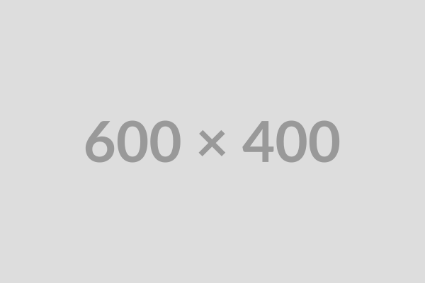

# Xref

Plugin que permet referenciar figures i taules pel seu identificador. El text de l'enllaç
és l'etiqueta de la llegenda (_Figura 2_, _Taula 1_), de manera que no cal reescriure els
enllaços quan canvie la numeració.

## Configuració

```yml title="properdocs.yml"
plugins:
  - material-joapuiib/xref
```

El plugin necessita que les llegendes estiguen numerades automàticament amb
`pymdownx.blocks.caption` (opció `auto: true`) i que tinguen un identificador.

## Sintaxi

Una __referència__ s'escriu amb `[@identificador]`, on l'identificador és el que s'ha definit
en la llegenda amb `#`:

```markdown

/// figure-caption | #figure-estructura-branques: Estructura de branques del repositori.

Com es veu en la [@figure-estructura-branques], ...
```

Aquesta mateixa sintaxi serveix per a qualsevol tipus de llegenda numerada (`figure-caption`,
`table-caption`...), ja que l'etiqueta es llig directament de la llegenda.

!!! example "Exemple: Referència a una figura de la mateixa pàgina"
    
    /// figure-caption | #figure-xref-exemple: Imatge de mostra.

    Passa el ratolí per damunt de [@figure-xref-exemple] per veure'n la vista prèvia.

## Referències entre pàgines

Si l'identificador no es troba en la pàgina actual, es busca en la resta del lloc. Per això,
els identificadors han de ser únics en tot el lloc.

!!! example "Exemple: Referència a una figura d'una altra pàgina"
    La figura [@figure-subtitol-imatge] està definida en [Subtítols](../features/subtitols.md).

Si un identificador apareix en diverses pàgines, el plugin avisa de l'ambigüitat. En aquest
cas, cal indicar la pàgina amb una ruta relativa al fitxer actual:

```markdown
[@../features/subtitols.md#figure-subtitol-imatge]
```

!!! warning "Els identificadors desconeguts generen un avís en la construcció."

    Amb `strict: true`, l'avís fa fallar la construcció.

## Vista prèvia

En passar el ratolí o el focus per damunt d'una referència, es mostra una finestra amb la
figura i la seua llegenda, igual que en les notes al peu. Funciona també amb les referències
a altres pàgines.

Al costat de cada referència apareix una icona que indica que l'enllaç té vista prèvia.
En els dispositius tàctils no es pot passar el ratolí per damunt, per això cal tocar la icona
per obrir la vista prèvia, mentre que l'enllaç porta a la figura. La finestra es tanca en
tocar fora d'ella. La icona no es mostra en imprimir el document.

## Codi

Les referències escrites dins de blocs de codi o de codi en línia no es transformen, de manera
que es poden mostrar com a exemple: `[@figure-id]`.
